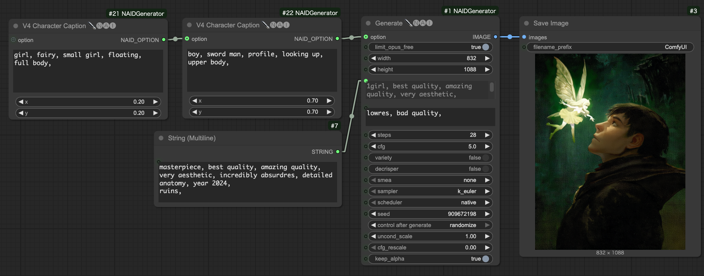
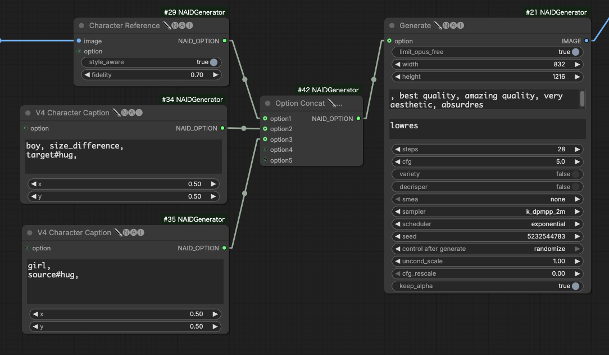

<a href="README.md">English</a> | <a href="README_ja.md">日本語</a>

# ComfyUI_NAIDGenerator

NovelAI API を使って画像生成を行うための [ComfyUI](https://github.com/comfyanonymous/ComfyUI) 拡張機能です。

## オリジナルの NAIDGenerator との違い。

このリポジトリは、[NAIDGenerator](https://github.com/bedovyy/ComfyUI_NAIDGenerator) から派生した改造版です。

オリジナルとは下記のような違いがあります。

- `VibeTransferOptionNAID` のV4系モデルに対応
- `V4CharacterCaption` ノード追加
- `Img2ImgOption` / `InpaintingOption` にオプション入力を追加
- `OptionConcatNAID` ノード追加
- ComfyUI Managerからインストールできないので手動で `git clone` する必要がある

## インストール

ComfyUI Managerからはインストールできません。<br>
ターミナルを起動して下記を実行してください。

```
# ComfyUIのカスタムノードフォルダにインストール
cd {ComfyUIインストールフォルダ}/custom_nodes
git clone https://github.com/da2el-ai/ComfyUI_NAIDGenerator

# 仮想環境のアクティブ化
# Windowsの場合
..\venv\Scripts\activate

# Mac / Linuxの場合
source ../venv/bin/activate

# 必要なライブラリのインストール
pip install -r requirements.txt
```

## NAI アカウント設定

ノードを使用する前に、ComfyUI 本体ディレクトリにある `.env` ファイルへ `NAI_ACCESS_TOKEN` を設定してください。

`ComfyUI/.env`
```
NAI_ACCESS_TOKEN=<YOUR_ACCESS_TOKEN>
```

永続的な API トークンは NovelAI サイトの **User Settings > Account > Get Persistent API Token** から取得できます。

または [novelai-api](https://github.com/Aedial/novelai-api) を使って、30 日間有効なアクセストークンを取得できます。

## 使い方

ノードは `NovelAI` カテゴリーにあります。


### Txt2img

`GenerateNAID` > `SaveImage` の順に接続します。


**注意:** `GenerateNAID` ノードで生成された画像は、元メタデータを保持するため自動的に `output/NAI_autosave/NAI_autosave_#####_.png` へ保存されます。

### Img2img

`Load Image` > `Img2ImgOptionNAID` > `GenerateNAID` の順に接続します。


**注意:** 元画像の幅と高さは、生成サイズに合わせてリサイズされます。

### Inpainting

`Load Image` > `InpaintingOptionNAID` > `GenerateNAID` の順に接続し、元画像とマスクを指定してください。


**注意:** 元画像とマスクはどちらも生成サイズに合うよう自動的にリサイズされます。

### Vibe Transfer

`nai-diffusion-4` 系以外を使う時には `ModelOptionNAID` を `VibeTransferOptionNAID` に接続します。<br>
`Load Image` > `VibeTransferOptionNAID` > `GenerateNAID` の順に接続します。


Img2Img など他のオプションと組み合わせることもできます。


#### 複数 Vibe Transfer

複数の `VibeTransferOptionNAID` ノードを接続して、影響を合成できます。


### Character Reference

`CharacterReferenceOptionNAID` ノードを使うと、1 枚の参照画像を使ってキャラクターの同一性やスタイルを誘導できます。


- **style_aware:** 有効にすると、キャラクターの特徴だけでなく画風もコピーしようとします。
- **fidelity:** 参照画像へどれだけ忠実に生成するかを制御します。開発者情報では `primary_strength` は常に `1.0` で、`secondary_strength` は $1.0 - \text{fidelity}$ で計算されます。

**注意:** 参照画像のアスペクト比を保つため、NAI が受け付けるキャンバスサイズへ自動的に変換されます。


### Character Caption

`V4CharacterCaptionNAID` を使うとキャラクター毎のプロンプト、位置の指定ができます。
`NAID_OPTION` に接続することで複数の `V4CharacterCaptionNAID` を使うことができます。

- **x:** 横方向の座標。左から右に `0`〜`1` で指定
- **y:** 縦方向の座標。上から下に `0`〜`1` で指定




### ModelOption

`GenerateNAID` ノードの既定モデルは `nai-diffusion-4-5-full` です。変更するには `ModelOptionNAID` ノードを接続してください。

利用可能な V4+ モデル:
- `nai-diffusion-4-curated-preview`
- `nai-diffusion-4-full`
- `nai-diffusion-4-5-curated`
- `nai-diffusion-4-5-full`


### NetworkOption

`NetworkOption` ノードでタイムアウトとリトライを設定できます。`ignore_errors` を有効にすると API エラー発生時にもキュー停止を防ぎ、エラー時は空の 1x1 画像を出力します。


**注意:** タイムアウトを短くしすぎると画像を受け取れない一方で、Anlas が消費される可能性があります。

### Anlas Tracker

この拡張には、使用量を確認するための Anlas トラッキング機能が含まれています。

**1. コンソール出力（自動）**
すべての生成ノードおよびディレクターツール系ノードは、処理の前後で Anlas 残高を ComfyUI 起動コンソールへ自動出力します。
```
[NovelAI] Anlas (pre-gen): 10000
[NovelAI] Generation cost: 20 Anlas
[NovelAI] Anlas (post-gen): 9980
```

**2. 可視化ノード**
`NovelAI/utils` カテゴリに **`Anlas Tracker ✒️🅝🅐🅘`** ノードが追加されています。ワークフロー内で現在の Anlas 残高を表示できます。

`anlas_string` 出力を表示ノード（例: [WAS Node Suite](https://github.com/WASasquatch/was-node-suite-comfyui) の「Show Text」）へ接続すると値を確認できます。`trigger` 入力で残高取得タイミングを制御します。

 <!-- Placeholder for actual image -->

### PromptToNAID

ComfyUI では強調に `()` または `(word:weight)` を使いますが、NovelAI では `{}` と `[]` を使います。このノード（`NovelAI/utils` 内）は、ComfyUI のプロンプト構文を NovelAI 形式へ変換します。


### Director Tools


`LineArtNAID`、`EmotionNAID`、`RemoveBGNAID` などのディレクターツールは `NovelAI/director_tools` カテゴリにあります。


### Option Concat

optionを結合するためのノードです。

基本的にはノード間のディジーチェーンでoptionを結合しますが、1箇所に集中したいという特殊な時に使用します。




### V4 / V4.5 対応

このノード群は NAI の V4 / V4.5 モデルアーキテクチャに完全対応しています。

#### V4 プロンプト処理

V4 / V4.5 のプロンプト処理向けに `NovelAI/v4` カテゴリへ次の 2 ノードが追加されています。

- **`V4BasePrompt`**: ポジティブプロンプトを処理
- **`V4NegativePrompt`**: ネガティブプロンプトを処理

#### V4 / V4.5 ワークフロー例

V4 / V4.5 モデル向けの基本構成は次の通りです。

```
V4BasePrompt -----> positive
                           GenerateNAID
V4NegativePrompt -> negative
```

**注意:** 基本的な `img2img`、`vibe transfer`、`inpainting` は V4 / V4.5 でも動作します。
